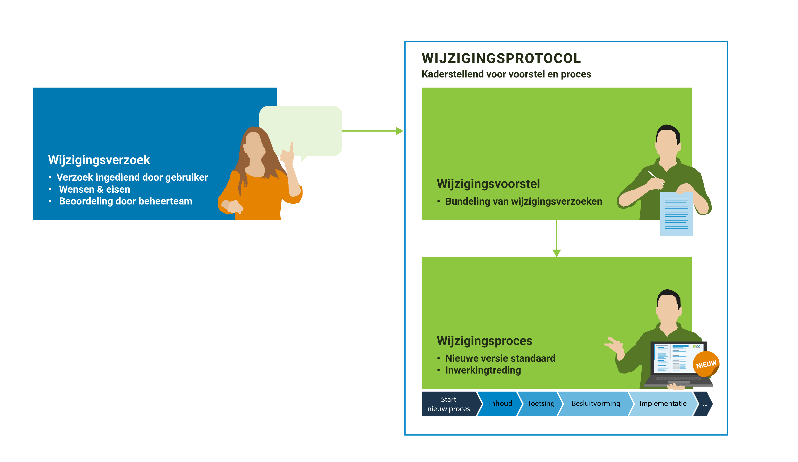

De NLDT Referentie Architectuur bevat afspraken en principes voor een stelsel van digitale tweelingen voor de fysieke leefomgeving. De referentie architectuur is bedoeld voor iedereen die een rol speelt bij het tot stand brengen van een digital twin of digitale tweeling voor de fysieke leefomgeving. De afspraken, uitgangspunten , principes en standaarden die in de referentie architectuur worden gepresenteerd, dragen bij aan het tot stand brengen van een stelsel dat bestaat uit vele toepassingen van het idee van digitale tweelingen.

De referentie architectuur is een "open" architectuur. Dat wil zeggen: de architectuur kan door iedereen, overheid en bedrijfsleven, toegepast worden. Toepassing van de afspraken, principes en standaarden draagt bij aan het tot stand brengen van een "ecosysteem", dat bestaat uit veel te verbinden databronnen en rekenmodellen. Hierdoor wordt het mogelijk om data en modellen uit uiteenlopende sectoren en kennisgebieden met elkaar te verbinden en daarmee twee- of driedimensionale beelden samen te stellen van de fysieke leefomgeving, beleidsvorming te ondersteunen met beslismodellen en simulaties of real time besturingsmogelijkheden voor operationele processen mogelijk te maken.

> Gebruikers en organisaties die in de praktijk werken met de referentie architectuur hebben vragen over de toepassing ervan, willen weten welke onderdelen van toepassing zijn, welke versies actueel zijn en welke ontwikkelingen spelen, en hebben mogelijk suggesties voor aanpassingen van de architectuur. Aanpassingen of wijzigingen in de architectuur worden niet zomaar doorgevoerd; voor de ene gebruiker zal een wijziging gering zijn, voor de ander kan het grote gevolgen hebben. Dit wijzigingsprotocol voor de NLDT Referentie Architectuur geeft inzicht in het wijzigingsproces van de architectuur, evenals de belangrijkste taken en verantwoordelijkheden van de betrokkenen (stakeholders) bij het onderhouden en gebruiken van de NLDT Referentie Architectuur. De stakeholders worden op diverse momenten betrokken in dit proces.

<figure id='d6aBfBiAa'></img>
<figcaption>Van wijzigingsverzoek tot een nieuwe versie van de standaard</figcaption></figure>

# Versiebeheer {#47B5C445}
Dit document wordt bijgewerkt op basis van ontwikkelingen rond het beheer van de NLDT Referentie Architectuur. In onderstaand overzicht houden wij de status van verschillende versies van dit document bij. Zo ziet u altijd wanneer de laatste versie is verschenen. 
<table style='width: 100%;'><caption>Tabel 1 - Versiebeheer van het document wijzigingsprotocol</caption>
<colgroup><col id='col1' style='width: 9.801876955161628%;'>
<col id='col2' style='width: 21.3532614992469%;'>
<col id='col3' style='width: 14.772332290580465%;'>
<col id='col4' style='width: 54.072529255011005%;'>
</colgroup>
<thead><tr><th class='left'>
<b>Versie</b>
</th>
<th class='left'>
<b>Datum</b>
</th>
<th class='left'>
<b>Status</b>
</th>
<th class='left'>
<b>Aanpassing</b>
</th>
</tr>
</thead>
<tbody>
<tr><td class='left'>
0.9
</td>
<td class='left'>
25 September 2026
</td>
<td class='left'>
Concept
</td>
<td class='left'>

</td>
</tr>
</tbody>
</table>