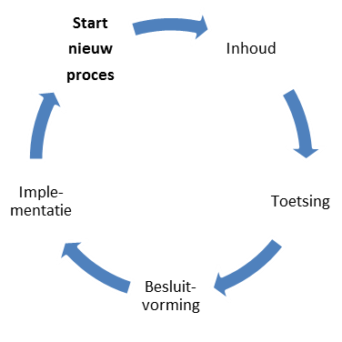

# Wijzigingsproces {#501FAB48}
De aanleiding voor een wijzigingsproces is gebaseerd op meldingen over de wensen en gevonden fouten in de <a href='https://docs.geostandaarden.nl/nldt/nldt-ra/' target='_blank'>NLDT Architectuur</a>. Dit zijn de wijzigingsverzoeken. Deze verzoeken worden door het beheerteam in behandeling genomen en in samenwerking met de werkgroep NLDT Architectuur verwerkt tot een wijzigingsvoorstel voor de architectuur. De beheerder neemt het initiatief om een wijzigingsproces te starten, de stappen in het proces zijn conform dit wijzigingsprotocol.

## Fasen in het wijzigingsproces {#554554BA}

Het volledige wijzigingsproces doorloopt de fasen Inhoud, Toetsing, Besluitvorming en Implementatie, zoals weergegeven in figuur 1.

<figure></img>
<figcaption>Fasen wijzigingsproces</figcaption></figure>

<b>Inhoud</b>
In de fase Inhoud wordt voor ieder wijzigingsverzoek bepaald of deze wordt opgenomen in de nieuwe versie van de architectuur of niet. Wijzigingsverzoeken zijn inzichtelijk via de publieke NLDT werkomgeving op GitHub. Voor wijzigingsverzoeken die worden meegenomen in de nieuwe versie van de architectuur, wordt de impact beschreven. Dit gebeurt in samenwerking met expert- en gebruikersgroepen, softwareleveranciers en de beheerder. Afhankelijk van de omvang van de wijziging ten opzichte van de voorgaande versie is de groep van te raadplegen experts evenredig groter of kleiner.
 
 
<b>Toetsing</b>
De fase Toetsing vormt een brug tussen de inhoud, besluitvorming en de implementatie. In deze fase wordt eenieder (in het geval van een X of Y wijziging) of een beperkte groep belanghebbenden (in het geval van een Z wijziging) uitgenodigd om zijn of haar visie te geven op het wijzigingsvoorstel. Met deze consultaties vragen wij de gebruikers van de architectuur actief hun reactie te geven op het wijzigingsvoorstel. Het wijzigingsvoorstel inclusief de terugkoppeling uit de consultatie wordt verwerkt tot release candidate van de architectuur.
 
 
<b>Besluitvorming</b>
Het wijzigingsvoorstel wordt inclusief de consulatie reacties voorgelegd aan de NLDT Stuurgroep. Zij voorziet het wijzigingsvoorstel van advies. Het GI-Beraad besluit, afhankelijk van het type wijziging (X, Y of Z, zie paragraaf 2.2), over de voorgestelde wijziging.
 
 
<b>Implementatie</b>
Het verwerken van het wijzigingsvoorstel in het NLDT Architectuur staat centraal in deze fase. Dit wordt gedaan door het beheerteam.

